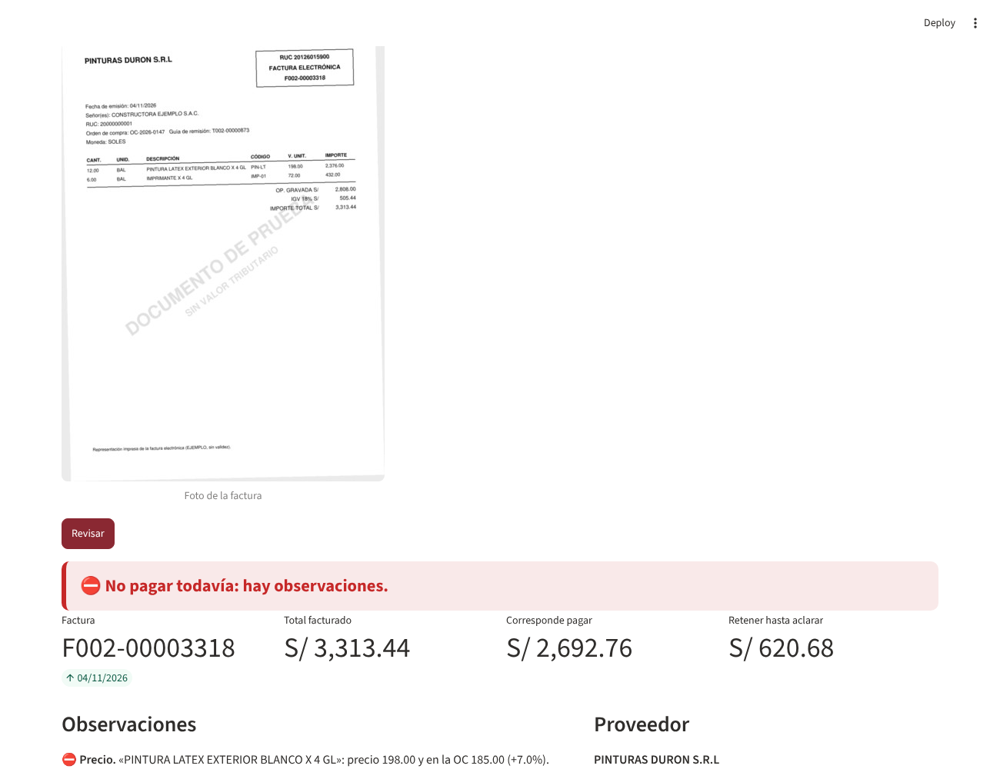
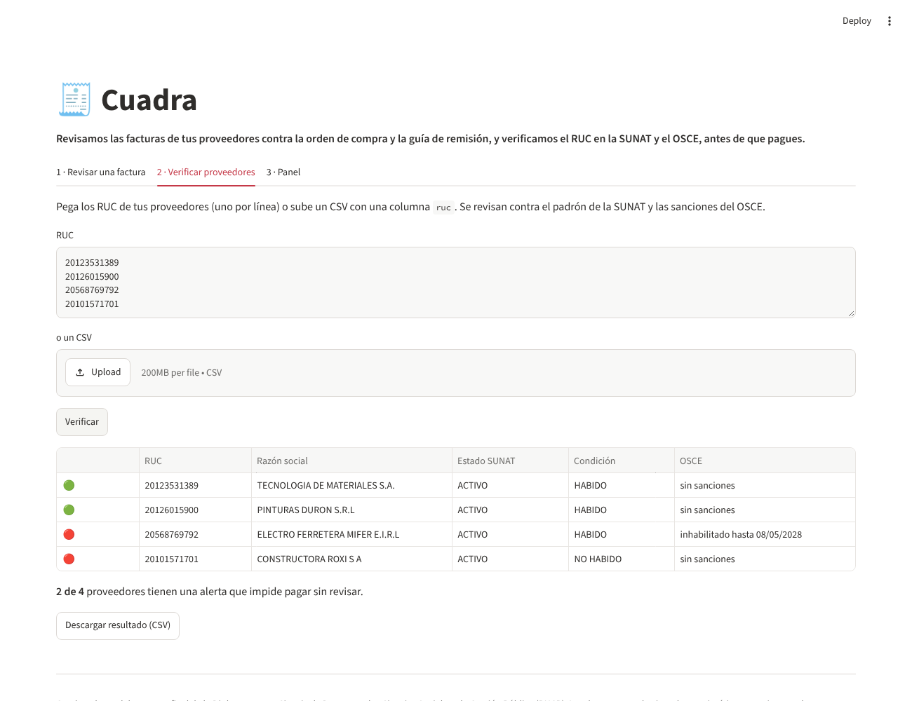
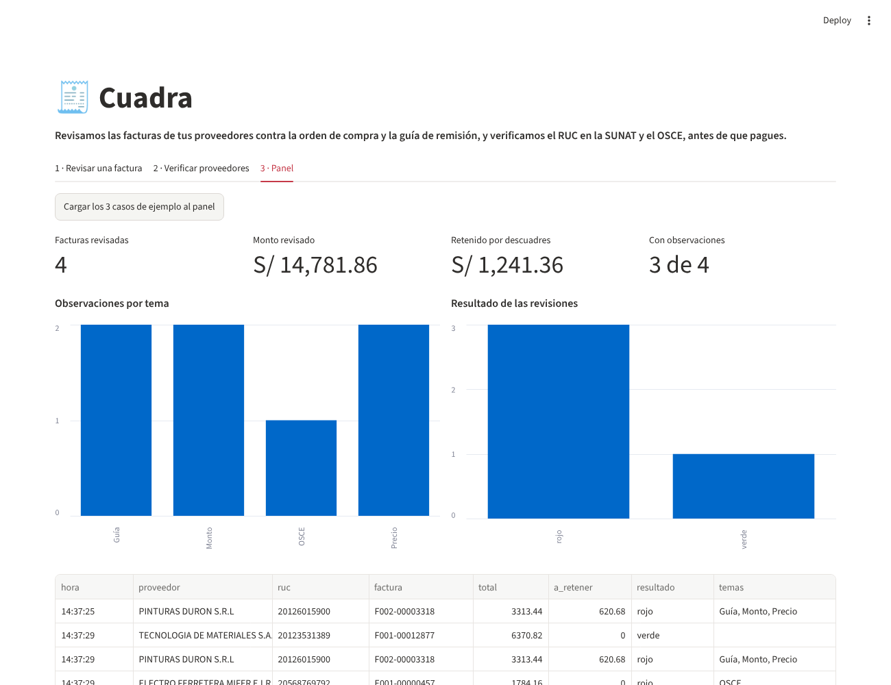
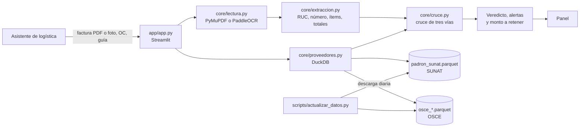

# Conforme

> **Revisamos las facturas de los proveedores de las constructoras pequeñas y medianas contra la orden de compra y la guía de remisión, y verificamos al proveedor en la SUNAT y el OSCE, antes de pagar.**

**Demo:** _URL pública por publicar_ · **Video de respaldo:** _por grabar_ · **Corre en local:** ver [Cómo correrlo](#cómo-correrlo)



---

## 1. One-liner

Hacemos el control de facturas de proveedores (el "cruce de tres vías" entre factura, orden de compra y guía de remisión) para los asistentes de logística y contabilidad de las constructoras pequeñas y medianas del Perú, mediante OCR abierto que corre en CPU y los datos públicos de la SUNAT y el OSCE.

## 2. Founder

**Oscar Andrés Chávez Inocente.** Bachiller en Economía por la PUCP y estudiante de la Diplomatura en Ciencia de Datos para las Ciencias Sociales y la Gestión Pública (PUCP). Portafolio: [o-chavx.github.io](https://o-chavx.github.io).

Por qué yo: en 2026 fui asistente administrativo de logística y recursos humanos en Técnica Ingenieros, en la obra de restauración del Congreso de la República. Mi trabajo incluía registrar y controlar las facturas de los proveedores, las órdenes de compra y las guías de remisión. Hacía a mano, en Excel y papel, el mismo cruce que hace Conforme.

Cómo cubro cada frente siendo una sola persona:

| Frente | Cómo |
|---|---|
| Producto | Mi experiencia en logística de obra y las 3 conversaciones de [`docs/research/`](docs/research/) |
| Ingeniería | Claude Code como socio técnico (ver la sección 9) |
| Diseño | Streamlit: interfaz simple, pensada para un asistente que revisa decenas de facturas |
| Ventas | Exjefes y excompañeros de obra, y gremios de contratistas (ver *Primeros usuarios*) |

## 3. Problema

**Quién lo sufre:** el asistente de logística o de contabilidad de una constructora pequeña o mediana con obras en curso, que antes de mandar a pagar tiene que comprobar, factura por factura, que:

- lo que se factura es lo que se pidió en la orden de compra (OC), al precio pactado;
- lo que se factura es lo que llegó a obra según la guía de remisión firmada por el residente;
- las cuentas de la factura están bien (importes, IGV y total);
- el proveedor está activo y habido en la SUNAT. Si está no habido, la empresa puede perder el crédito fiscal del IGV de esa factura.

**Cómo lo resuelven hoy:** a mano. Se imprime o se abre la factura, se busca la OC en un Excel o en el correo, se busca la guía firmada en un archivador o en una foto de WhatsApp, y se compara línea por línea. La consulta RUC de la SUNAT se hace de a un RUC, con captcha, y casi nunca se revisa el registro de sancionados del OSCE.

**Cuánto les cuesta:** _se completa con las 3 conversaciones (tiempo por factura, facturas al mes y el último descuadre que recuerdan)._

**Evidencia:** notas de 3 conversaciones con usuarios potenciales en [`docs/research/`](docs/research/).

## 4. Solución e insight

Conforme recibe la factura (en PDF o en foto), la orden de compra y la guía de remisión, y en unos segundos:

1. **Lee los tres documentos.** Si el PDF trae texto, lo lee directamente. Si es una foto o un escaneo, usa PaddleOCR, corrige la inclinación de la foto y arma las filas de la tabla.
2. **Extrae los campos** que la SUNAT exige en la representación impresa: RUC, serie y número, fecha, ítems, valor de venta, IGV y total. También extrae las referencias cruzadas: qué OC y qué guía cita la factura.
3. **Cruza ítem por ítem:** precio contra la OC, cantidad contra la guía, ítems facturados que no se pidieron o no llegaron, y la aritmética de la factura.
4. **Verifica al proveedor** con datos públicos y reales: el padrón de RUC de la SUNAT (estado y condición de domicilio) y los proveedores sancionados por el Tribunal de Contrataciones del Estado (inhabilitaciones y multas).
5. **Da un veredicto** ("Todo cuadra", "Revisar" o "No pagar todavía") y el **monto a retener** hasta aclarar, con IGV.

Además, verifica una lista completa de proveedores de una sola vez (pegada o en CSV) y lleva un panel con lo revisado y lo retenido.

**Insight:** el problema no es leer la factura, que ya lo hacen muchos OCR. Lo que cuesta es **cruzarla** con otros dos documentos que viven en lugares distintos (la OC en logística, la guía en obra) y con el estado del proveedor, que cambia todos los días. Y las constructoras pequeñas no tienen un ERP que haga ese cruce: lo hacen personas, con Excel y WhatsApp.

## 5. Why now

- **OCR abierto que corre en CPU.** PaddleOCR v5 (2025) lee una factura en segundos en una laptop o en un servidor gratuito, sin pagar por página a una API.
- **Datos públicos al día.** La SUNAT publica a diario el padrón reducido de RUC (más de 2.3 millones de personas jurídicas) y el OSCE publica en datos abiertos a sus proveedores sancionados. Con DuckDB se consultan en milisegundos sin montar una base de datos.
- **Facturación electrónica obligatoria.** Casi todas las facturas ya nacen digitales y tienen un formato estándar, lo que hace posible leerlas con reglas.
- **Una sola persona puede construirlo.** Con Claude Code, el producto completo se armó en días.

## 6. Demo

**URL:** _por publicar en Streamlit Community Cloud_. Para correrlo en local, ver abajo.

**El flujo del demo (2 minutos):**

1. *Revisar una factura* → caso **"Cobra de más"**, con la **foto** de la factura (PaddleOCR) → **Revisar**.
2. Conforme detecta que se facturan **12 baldes de pintura y a obra llegaron 10**, y que el precio subió de **S/ 185 a S/ 198** frente a la OC. Dice **"No pagar todavía"** y que hay que **retener S/ 620.68**.
3. Caso **"Proveedor con alerta"**: los documentos cuadran, pero el proveedor tiene una **inhabilitación vigente del OSCE**, con dato real del corte de noviembre de 2026.
4. *Verificar proveedores*: cuatro RUC reales, y se ve en vivo cuál está **no habido** en la SUNAT y cuál está **inhabilitado** por el OSCE.
5. *Panel*: facturas revisadas, monto retenido y observaciones por tema.

| Revisar una factura | Verificar proveedores | Panel |
|---|---|---|
|  |  |  |

### Arquitectura



### Modelos, APIs y por qué

| Pieza | Qué usamos | Por qué |
|---|---|---|
| Leer PDF digital | PyMuPDF | La representación impresa de una factura electrónica ya trae texto: leerlo es exacto, instantáneo y gratis. |
| Leer fotos y escaneos | PaddleOCR v5 (`PP-OCRv5_mobile_det` + `latin_PP-OCRv5_mobile_rec`) | Abierto, en español, corre en CPU en segundos y los documentos no salen del servidor. Los modelos *mobile* caben en un plan gratuito. |
| Estructurar los campos | Reglas en Python (`core/extraccion.py`) | Los campos de una factura electrónica son estándar. Con reglas no hay costo por factura ni claves de API, y el resultado es reproducible. |
| Verificar al proveedor | Padrón reducido de RUC (SUNAT) y sancionados del Tribunal de Contrataciones (OSCE), consultados con DuckDB | Son datos oficiales, públicos y gratuitos. La consulta en línea de la SUNAT tiene captcha y no sirve para revisar lotes. |
| Interfaz y panel | Streamlit | Se despliega gratis y la usa cualquiera desde el navegador. |

Conforme **no usa ningún LLM ni API de pago**, así que no hay claves que cuidar (`.env.example` lo explica).

### Cómo correrlo

```bash
git clone https://github.com/O-Chavx/Presentacion_StartUp.git
cd Presentacion_StartUp
python -m venv .venv && source .venv/bin/activate   # en Windows: .venv\Scripts\activate
pip install -r requirements-dev.txt
streamlit run app/app.py
```

Los datos públicos ya vienen en `data/publicos/`. Para actualizarlos al día:

```bash
python scripts/actualizar_datos.py   # baja unos 400 MB de la SUNAT y deja un parquet de 40 MB
```

Otros comandos:

```bash
python scripts/generar_ejemplos.py   # vuelve a generar los 3 casos de ejemplo
pytest -q                            # 11 pruebas
```

### Los datos del demo

- **Documentos:** las facturas, órdenes de compra y guías de [`data/ejemplos/`](data/ejemplos/) son **sintéticas**. Las genera `scripts/generar_ejemplos.py` y llevan la marca "DOCUMENTO DE PRUEBA - SIN VALOR TRIBUTARIO". El comprador es una constructora ficticia.
- **Proveedores:** los RUC y razones sociales son de empresas reales, tomadas del padrón público de la SUNAT, para que la verificación se haga con datos reales. **Las operaciones, precios y descuadres son inventados** y no describen ninguna transacción real de esas empresas. Su estado en la SUNAT y sus sanciones del OSCE sí son los publicados.
- **Datos personales:** del padrón solo se guardan personas jurídicas (RUC 20). Se excluyen las personas naturales con negocio (RUC 10).

## 7. Modelo de negocio

**Quién paga:** la constructora (gerencia o administración), no el asistente. Lo justifica el dinero que deja de pagar de más y el crédito fiscal que no pierde.

| Plan | Precio | Incluye |
|---|---|---|
| Gratis | S/ 0 | Verificación de hasta 50 RUC al mes y 10 facturas revisadas |
| Obra | **S/ 149 al mes** | Hasta 300 facturas al mes, una obra, verificación ilimitada de proveedores, historial y exportación a Excel |
| Empresa | **S/ 449 al mes** | Facturas ilimitadas, varias obras y usuarios, alertas cuando un proveedor cambia de estado en la SUNAT o el OSCE |

**Cuánto cuesta cada cliente** (plan Obra, 300 facturas al mes):

| Concepto | Costo mensual estimado |
|---|---|
| Tokens de LLM | S/ 0 (no se usa LLM) |
| OCR | S/ 0 en APIs: PaddleOCR corre en nuestro servidor, unos 3 a 5 s de CPU por foto |
| Servidor | Un servidor de 2 vCPU y 4 GB (unos US$ 24 al mes) atiende a más de 30 clientes, así que son menos de S/ 3 por cliente |
| Datos de la SUNAT y el OSCE | S/ 0 (públicos) |
| **Total por cliente** | **menos de S/ 5 al mes** |

**Margen de contribución:** más del 95 % en el plan Obra. El costo principal de crecer es vender, no servir.

**Qué sigue:**

1. Leer el XML de la factura electrónica (el formato UBL de la SUNAT), que es exacto.
2. Recibir las facturas por correo o por WhatsApp.
3. El segundo módulo: los **expedientes del personal de obra** (contratos, SCTR y exámenes médicos), que avisa qué documentos faltan o están por vencer.

## 8. Herramientas del curso

| Herramienta | Sesión | Dónde está | Por qué esta |
|---|---|---|---|
| **Document AI con PaddleOCR** | 10 | [`core/lectura.py`](core/lectura.py), [`core/extraccion.py`](core/extraccion.py) | Las facturas llegan como foto o como PDF. El OCR abierto las lee sin enviarlas a terceros y sin costo por página. |
| **Scraping y APIs de datos públicos** | 03 | [`scripts/actualizar_datos.py`](scripts/actualizar_datos.py), [`core/proveedores.py`](core/proveedores.py) | Descarga y procesa el padrón de la SUNAT y los registros de sancionados del OSCE: la parte del producto que usa datos reales. |
| **Dashboard** | 05 | [`app/app.py`](app/app.py), pestaña *Panel* | Para que la jefatura vea cuánto se revisó, cuánto se retuvo y qué tipo de problemas se repiten. |

## 9. Qué hizo el agente

Usé Claude Code como socio técnico en todo el proyecto. Lo que hizo:

- **Investigación de datos:** encontró las fuentes públicas (el padrón reducido de RUC y los archivos del OSCE en datos abiertos), comprobó que se podían descargar y diseñó el filtrado a personas jurídicas.
- **Código:** escribió la primera versión de `core/` (lectura con PyMuPDF y PaddleOCR, corrección de la inclinación de la foto, extracción por reglas, cruce de tres vías y consulta con DuckDB), de la app en Streamlit, del generador de documentos de ejemplo y de las pruebas.
- **Depuración:** resolvió un error de PaddleOCR 3.3 con oneDNN en CPU (`enable_mkldnn=False`) y la detección de la guía de remisión, que se confundía con una orden de compra.
- **Documentación:** el borrador de este README.

Lo que hice yo: elegí el problema a partir de mi trabajo en logística de obra, definí qué controles importan y cómo se ve un descuadre real, hice las 3 conversaciones con usuarios, revisé el código y los resultados, y decidí el modelo de negocio.

---

## Opcional

**Competencia:**

| Alternativa | Por qué no basta |
|---|---|
| No hacer nada | Se paga lo que diga la factura: los descuadres se descubren tarde, o nunca. |
| Excel y la consulta RUC de la SUNAT | Toma tiempo, es de a un RUC y con captcha, y no revisa al OSCE. |
| ERP grandes (SAP, Oracle) | Hacen el cruce de tres vías, pero cuestan demasiado y tardan en implementarse para una constructora pequeña. |
| OCR de facturas genéricos | Leen la factura, pero no la cruzan con la OC y la guía ni con la SUNAT y el OSCE. |

**Primeros usuarios:** 10 constructoras de mi red (exjefes y excompañeros de obra) con el plan gratis; luego 100, con contadores externos que llevan a varias constructoras; luego 1,000, con gremios de contratistas y alianzas con estudios contables.

**Riesgos:** (1) que los formatos de factura de algunos proveedores no se lean bien, lo que se mitiga leyendo el XML; (2) que los datos públicos cambien de URL, lo que se mitiga con alertas en la descarga diaria; (3) que la confianza dependa de los falsos positivos, por eso cada alerta muestra la evidencia.

## Licencia

[MIT](LICENSE)
